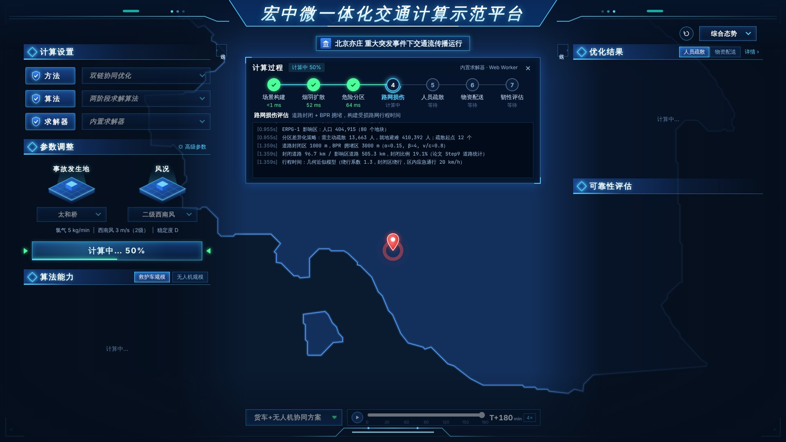
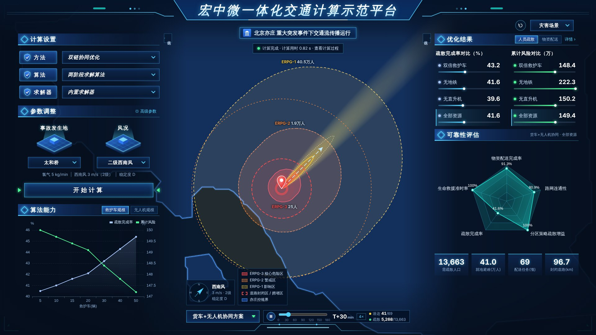

# 重大突发事件交通应急模拟模块（接入“宏中微一体化交通计算示范平台”）

面向一体化平台 `traffic-screen` 首页 **“重大突发事件”** 入口的模拟模块。界面按同事设计稿《系统UI.jpg》实现，计算方法来自论文
《城市快速路危险品车辆事故场景下的应急物资配送与多类型人员救援疏散协同优化研究——以北京六环路为例》（CSTFM 2026, CT007）及其 `scripts/step9~step12`。


| 计算过程（7 阶段流水线 + 求解日志） | 灾害场景（烟羽 + ERPG 分区 + 封闭/拥堵圈） |
|---|---|
|  |  |
| **物资配送（货车—无人机协同路线与回放）** | **人员疏散（起点剩余人数 + 多方式疏散流）** |
|  |  |
| **结果详情 · 论文对照** | **高级参数** |
|  |  |

> 截图在无外网环境生成，底图瓦片未加载；部署到平台后会显示高德深色化底图（见“运行时配置”）。

---

## 1. 交付内容

```
emergency-sim-platform/
├── dist/                      ★ 已构建好的前端（可直接部署，含 data/ 与 config.js）
├── public/
│   ├── config.js              运行时配置（底图、接口地址、标题等，部署后可直接改）
│   └── data/                  ★ 平台所需数据（见第 5 节）
├── src/
│   ├── engine/                ★ 计算引擎（纯 JS，浏览器/Node 通用，无 DOM 依赖）
│   │   ├── defaults.js          论文参数、预设、常量
│   │   ├── plume.js             高斯烟羽扩散
│   │   ├── zones.js             ERPG 分区（距离变换缓冲）、地块人口统计
│   │   ├── travel.js            受损路网行程时间（几何近似 / 可选真实路网 Dijkstra）
│   │   ├── evacuation.js        多类型人员疏散时间步进调度
│   │   ├── supply.js            货车—无人机协同物资配送（贪心 + 2-opt）
│   │   └── index.js             计算流程编排 + 韧性评估
│   ├── components/            Vue 3 大屏组件（左/右面板、地图、计算过程、回放、详情、高级参数）
│   ├── workers/sim.worker.js  Web Worker（后台计算，不阻塞界面）
│   ├── services/simService.js 求解器适配（本地 Worker / 服务端 REST 流式）
│   └── store.js               全局状态
├── server/index.js            可选：服务端求解 REST API（同一引擎，零框架依赖）
├── tools/
│   ├── build_default_data.py  由仓库内论文成果生成默认数据（已运行）
│   ├── export_platform_data.py★ 由论文原始数据输出导出真实数据（替换近似数据）
│   └── run_cli.js             命令行运行引擎并与论文对照
├── tests/engine.test.js       引擎测试（11 项，含与论文数值对照）
├── examples/
│   ├── EmergencySimEntry.vue  traffic-screen 路由页面示例（iframe 接入，Vue2/3 通用）
│   └── iframe-demo.html       父页面 ↔ 模块 postMessage 交互示例
├── deploy/                    nginx 配置示例、Dockerfile
└── docs/
    ├── 模型与设计说明.md        界面设计、计算流程、公式参数、与论文的差异、验证
    └── 接口文档.md             REST API、结果 JSON 结构、postMessage 协议、数据格式
```

技术栈：Vue 3.5 + Vite 6 + ECharts 5（按需引入）+ Leaflet 1.9 + d3-contour。构建产物约 0.9 MB（gzip 约 290 KB）+ 数据 0.25 MB。

## 2. 快速开始

```bash
cd emergency-sim-platform
npm install
npm run dev        # 开发调试 http://localhost:5173
npm test           # 引擎测试（11 项）
npm run build      # 构建到 dist/
npm run server     # 可选：服务端求解 API + 静态前端 http://localhost:8787
npm run sim        # 命令行跑一次基准场景，输出与论文的对照
```

Node ≥ 18（推荐 22）。

## 3. 接入一体化平台（三选一）

### 方式 A：iframe 嵌入（推荐，零耦合）

1. 将 `dist/` 整个目录部署到平台同域路径，例如 `https://39.98.51.213/traffic-screen/emergency-sim/`（nginx 见 `deploy/nginx.conf.example`）。
2. 在 `traffic-screen` 路由中新增页面 `examples/EmergencySimEntry.vue`（Vue 2/3 通用），首页“重大突发事件”入口 `router.push('/emergency')`。
3. 需要联动时用 postMessage（见 `docs/接口文档.md` 第 3 节）：父页面可下发 `emergency-sim:run / set`，模块每次计算完成回传 `emergency-sim:result` 摘要。

`dist/` 使用相对路径（`base: './'`），放在任何子路径下都能运行，无需改代码。

### 方式 B：源码并入 traffic-screen（Vue 3 项目）

1. 复制 `src/engine`、`src/components`、`src/workers`、`src/services`、`src/store.js`、`src/styles/theme.css`、`src/App.vue`（可改名为 `EmergencySimView.vue`）。
2. 安装依赖：`npm i echarts@5 leaflet@1.9 d3-contour@4`。
3. `public/data/` 拷入平台静态目录，`public/config.js` 的内容可并入平台配置（`window.EMERGENCY_SIM_CONFIG`）。
4. 大屏缩放：本模块自带 1920×1080 等比缩放（地图层不缩放以保证交互精度）；若平台已有统一缩放容器，去掉 `App.vue` 中的 `screenStyle` 即可。
5. 若平台已使用高德 JS API 等地图组件，可参照 `components/MapView.vue` 的图层划分迁移（数据均为 WGS84，需要时调用引擎导出的 `wgs84ToGcj02`）。

若 traffic-screen 为 Vue 2：引擎（`src/engine`）与 Worker 可直接复用，界面组件建议用方式 A。

### 方式 C：服务端求解

`node server/index.js`（或 `deploy/Dockerfile`）提供 `POST /api/emergency/simulate`，前端“求解器”选择 **服务端求解器** 即走该接口（NDJSON 流式回传计算过程）。也可供平台其他模块直接调用计算。接口详见 `docs/接口文档.md`。

## 4. 运行时配置 `config.js`

部署后直接编辑 `dist/config.js`，无需重新构建：

| 配置项 | 说明 | 默认 |
|---|---|---|
| `title` / `subtitle` | 大屏标题、副标题 | 宏中微一体化交通计算示范平台 / 北京亦庄 重大突发事件下交通流传播运行 |
| `map.tileUrl` `map.subdomains` | 底图瓦片地址 | 高德栅格 `webrd0{s}.is.autonavi.com` |
| `map.coord` | 底图坐标系：`gcj02`（高德/腾讯）或 `wgs84`（天地图/OSM/内网 WGS84 底图） | `gcj02` |
| `map.darkFilter` | 浅色瓦片深色化（贴合设计稿深蓝风格）；底图本身为深色时设为 `false` | `true` |
| `map.center` `map.zoom` | 初始中心（WGS84）与级别 | 太和桥，13 |
| `dataBase` | 数据目录 | `./data/` |
| `apiBase` | 服务端求解器地址（同域部署留空） | `''` |
| `stageDelayMs` | 计算过程每阶段最短展示时长（实际计算约 1 s，延时用于展示流程）；设 0 即时出结果 | 450 |
| `autoRun` | 打开页面自动计算一次基准场景 | `true` |

## 5. 数据说明（`public/data/`）

| 文件 | 内容 | 来源 | 是否近似 |
|---|---|---|---|
| `facilities.json` | 消防站 8、假设应急仓库 2、避难所/中转站 6、医院 10、地铁站 8、通勤方式构成 | 论文 Step10/11 输出的物流网络节点（原始 POI 坐标） | 地铁站坐标为近似值（`approx: true`）；避难所容量、医院床位取论文代码默认值 |
| `population.json` | 地块人口标签栅格（480×477，约 75 m）+ 2,995 个地块人口 + 年龄结构 | 由 `figures/step4_population.png` 反演（色带逆映射 + 连通域分割），按 Step11 ERPG 分区人口标定 | **近似**：ERPG-2/1 分区人口与论文偏差 −2.7% / −0.5%（表见 `meta.calibration`） |
| `yizhuang_boundary.geojson` | 亦庄控规界（219.5 km²） | 由 Step4 图中控规界线数字化 | 约 75 m 精度 |
| `paper_reference.json` | 论文 Step9–12 全部关键结果、危险区 GeoJSON | `技术路线图/9~12_*` | 原值 |
| `road_network.json`（可选，默认无） | 路网节点/有向边 | 导出脚本由 `road_network_graph.gpickle` 生成 | 原值 |

**用真实数据替换（强烈建议）**：原始地块人口、POI 全集、路网在作者本机（`scripts/config.py` 中的路径），未纳入仓库。导出脚本读取的是论文数据处理脚本 step0–step8 的 **输出**（`output/0_study_area`、`1_road_network`、`2_poi`、`3_population`、`5_commute`、`8_integrated`），需要先有这些输出：

```bash
# 第 1 步（若 output/ 下还没有文件）：在仓库的论文目录生成输出，需能访问 config.py 中的原始数据（含外接硬盘）
cd 1-CSTFM2026会议投稿
python run_all.py --only 0 2 3 4      # 研究范围、路网、POI、人口（必需）
python run_all.py --only 5 8          # 通勤方式构成、应急仓库（可选，缺失时沿用默认数据）

# 第 2 步：检查 → 导出
cd ../emergency-sim-platform
pip install geopandas networkx
python tools/export_platform_data.py --research-output ../1-CSTFM2026会议投稿/output --check
python tools/export_platform_data.py --research-output ../1-CSTFM2026会议投稿/output
npm run build    # 或直接把 public/data/* 覆盖到已部署的 dist/data/
```

- `--check` 只列出每个输入文件找到/缺失及其由哪个 step 生成，不写入任何文件。
- `--research-output` 也可以给上级目录（例如当初运行脚本的旧工作目录），脚本会在子目录中自动搜索。
- 找不到任何核心输入时脚本不写入任何文件并退出；只找到部分输入时按类别更新（例如只有 POI 时仅替换设施，人口/路网保持现状）。
- 每次覆盖前，原文件备份到 `data_backup/<时间戳>/`（不会被打包进 dist）。
- 注意：`scripts/config.py` 被导入时会自动创建 `output/` 下的空子目录，因此 `output/` 存在但没有文件，通常说明该位置从未完整运行过 step0–step4。

生成同格式文件后无需改代码；有 `road_network.json` 时引擎自动改用 Dijkstra 路网行程时间（与 `network_router.py` 一致的封闭 + BPR 规则）。

## 6. 计算内容一览

点击 **开始计算** 后依次执行 7 个阶段（界面中部“计算过程”面板实时显示进度与求解日志）：

1. **场景构建**：事故点、危化品、泄漏速率、风向风速（蒲福风级）、稳定度、资源池；风力 >6 级判定无人机停飞。
2. **高斯烟羽扩散**：±10 km、50 m 网格，Briggs 城市扩散参数（与 Step9 `plume_concentration.npz` 逐点一致）。
3. **ERPG 危险分区**：ERPG-3/2/1（20/3/1 mg/m³）等值线外扩 500/1500/3000 m，地块人口统计（论文 gpd.clip 口径），分区差异化疏散/就地避难。
4. **路网损伤**：1 km 封闭、3 km BPR 拥堵（α=0.15，β=4，v/c=0.8），道路封闭比例。
5. **多类型人员疏散**：5 种方式 × 3 类人群，Δt=5 min、T=180 min 风险感知调度；方案对比（全部资源 / 双倍救护车 / 无地铁 / 无直升机 / 严格优先级）+ 救护车规模敏感性。
6. **应急物资配送**：供应点—中转站—需求点三层网络，四类物资时间窗，含就地避难人口派生需求；贪心构造 + 2-opt；方案对比（纯货车 / 货车+无人机协同 / 加倍无人机 / 纯无人机）+ 无人机规模敏感性。
7. **韧性评估**：结构（路网连通性）、功能（配送完成率、生命救援准时率、疏散完成率）、适应（分区策略疏散增益、接力增量）。

界面映射（与设计稿一致）：左侧“计算设置/参数调整/开始计算/算法能力（敏感性曲线）”，右侧“优化结果（疏散完成率对比、累计风险对比；可切换物资配送）/可靠性评估（雷达图）”，底部“方案下拉 + 时间轴回放”，右上“场景界面（综合态势/灾害场景/物资配送/人员疏散）”。详见 `docs/模型与设计说明.md`。

## 7. 与论文结果的对照（基准场景：太和桥 · 西南风 3.0 m/s · D 类 · 氯气 5 kg/min）

| 指标 | 平台 | 论文 |
|---|---|---|
| ERPG-2 / ERPG-1 分区人口 | 19,133 / 404,915 | 19,657 / 407,115 |
| 需主动疏散人口 | 13,663 | 13,830 |
| 道路封闭比例 | 19.1% | 19.1% |
| 疏散率：全部资源 / 无直升机 / 无地铁 | 41.6% / 39.6% / 41.6% | 41.0% / 40.2% / 38.8% |
| k=2 脆弱群体 / k=1 重伤疏散率 | 100% / 5.8% | 100% / 4.3% |
| 配送完成：纯货车 / 协同 | 62/69 / 63/69 | 64/70 / 62/70 |
| Makespan：纯货车 / 协同 | 62.9 / 48.1 min | 47.3 / 59.9 min |
| 生命救援 30 min 准时率 | 100% | 100% |

人口、疏散两条主线与论文高度一致；物资配送 Makespan 方向与论文相反，原因是默认数据没有真实路网：论文路由按道路限速（快速路 80–100 km/h）计时，平台默认几何模型按论文参数“货车均速 40 km/h”计时，直送更慢、接力更有利。导出 `road_network.json` 并在高级参数中关闭“路网车速上限”（`roads.vehicleSpeedCap=false`，即与 `network_router.py` 一样只按道路自由流速度计时）后，行程时间口径与论文一致。完整差异说明见 `docs/模型与设计说明.md` 第 5 节。

## 8. 说明与已知限制

- 开发环境无法访问 `https://39.98.51.213/traffic-screen/#/home` 与 `39.98.51.213/screen/#/chart/preview/874`，界面严格按《系统UI.jpg》实现；“计算过程”面板为依据论文技术路线自行设计，可按一体化平台其他页面的计算过程样式微调（`components/ProcessOverlay.vue`）。
- 设计稿“方法：双侧优化 / 求解器：CMIP求解器”在实现中对应为“双链协同优化”（论文“向心流—离心流”双链）与“内置求解器 / 服务端求解器”；本论文方法为启发式算法，未引入 MIP 求解器，如需接入可在服务端扩展。
- 设计稿雷达“道路封闭比例”轴按论文图 4 改为“路网连通性 = 1 − 道路封闭比例”，保证雷达各轴越大越好；悬浮提示中给出封闭比例原值。
- 事故发生地预设目前仅“太和桥”（论文场景），另支持 **地图选点**；其他点位可在 `src/engine/defaults.js` 的 `SITES` 中追加。非太和桥点位在无路网数据时，道路封闭比例按太和桥道路长度剖面近似（界面以“≈”标注）。
