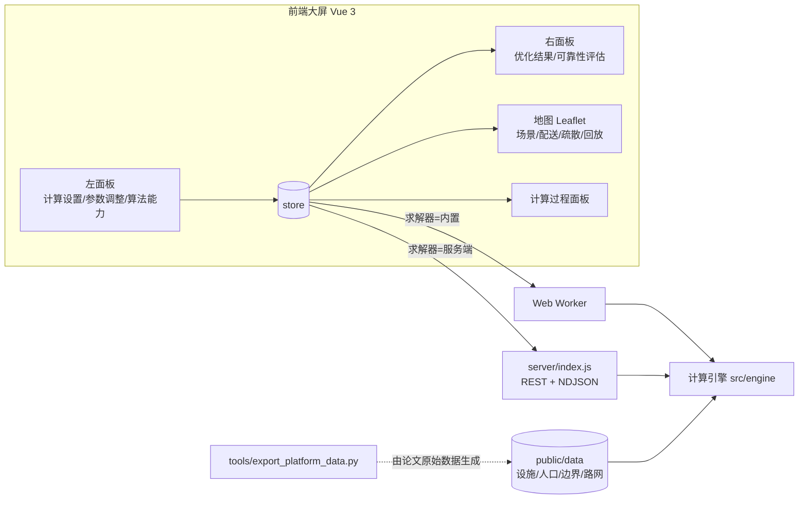

# 模型与设计说明

本文档说明模拟模块的界面设计、计算流程、模型公式与参数、指标定义，以及与论文代码（`1-CSTFM2026会议投稿/scripts/step9~12`）的对应关系和差异。

## 1. 总体架构

- **引擎与界面解耦**：`src/engine` 为纯 ES Module，无 DOM 依赖，浏览器 Worker 与 Node 服务端共用同一份代码，结果一致。
- **数据与代码解耦**：所有数据在 `public/data`，运行时配置在 `public/config.js`，部署后均可直接替换。
- **两种求解器**：内置（浏览器 Worker，默认，不需要后端）与服务端（REST，NDJSON 流式回传计算过程），由左侧“求解器”下拉切换。

## 2. 界面设计（对照《系统UI.jpg》）

画布 1920×1080，等比缩放；地图铺满视口且不参与缩放（保证地图交互坐标准确）。

| 设计稿元素 | 实现 | 说明 |
|---|---|---|
| 顶部标题“宏中微一体化交通计算示范平台” | `ScreenHeader.vue` | 梯形标题牌 + 两侧折线点阵装饰；标题文字可在 `config.js` 修改 |
| 副标题“北京亦庄 重大突发事件下交通流传播运行” | 同上 | |
| 右上 刷新按钮 + “场景界面”下拉 | 刷新=恢复论文基准并重算；下拉=综合态势 / 灾害场景 / 物资配送 / 人员疏散 | 切换地图图层组合并自动缩放视野 |
| 计算设置：方法 / 算法 / 求解器 | 方法：双链协同优化 / 人员疏散优化 / 物资配送优化 算法：两阶段求解算法（论文）/ 两阶段·直送优先 / 贪心构造算法 求解器：内置求解器 / 服务端求解器 | “双链”即论文的“离心流（疏散）—向心流（物资）”耦合：疏散产生的就地避难人口转化为物资需求 |
| 参数调整：事故发生地 / 风况（发光平台图标 + 下拉） | 事故发生地：太和桥 / 地图选点；风况：7 个预设（含论文 4 个风向敏感性情景） | “⚙ 高级参数”打开全部模型参数 |
| 开始计算 | 按钮内显示进度条 | 计算中禁用参数修改 |
| 算法能力（折线图） | 救护车规模敏感性：疏散完成率 & 累计风险；无人机规模敏感性：配送完成率 & Makespan | 对应论文图 3(c) 救护车敏感性与 Step10 无人机敏感性 |
| 地图：亦庄控规界蓝色高亮 + 红色事故点 | 控规界多边形 + 脉冲事故点；叠加烟羽浓度、ERPG 分区、封闭/拥堵圈、风向箭头、设施、路线、疏散流、车辆 | |
| 底部“货车+无人机协同方案”下拉 | 配送方案选择（纯货车 / 协同 / 加倍无人机 / 纯无人机），并新增时间轴回放 | 回放 0–180 min：车辆沿路线移动，疏散起点剩余人数实时变化 |
| 优化结果：疏散完成率对比（%）/ 累计风险对比（万），4 行（双倍救护车、无地铁、无直升机、全部资源） | 同设计稿；新增“物资配送”页签（配送完成率 / Makespan）与“详情” | 点击某行即在地图上切换为该方案 |
| 可靠性评估（五边形雷达） | 物资配送完成率、生命救援准时率、疏散完成率、分区策略疏散增益、路网连通性 | 随当前选择的配送/疏散方案联动 |
| —（新增） | 计算过程面板、地图图例与风向罗盘、关键指标卡、结果详情弹窗（含论文对照、调度明细、导出 JSON）、高级参数弹窗 | |
| —（新增）地图底图与路网 | 底图切换（深色街道 / 卫星影像 / 标准街道 / 无底图）；`basemap.json` 矢量图层：12 级道路按缩放级别分级显示、道路名称沿路走向标注并避让、地铁线路（官方配色）与站点；计算后路网状态：封闭半径内红色，拥堵半径内按 BPR 行程时间系数 f 分为严重拥堵（f ≥ 1.5）/ 拥堵（≥ 1.25）/ 缓行，道路按约 80 m 细分后逐段着色；右下角缩放、复位、图层面板与比例尺 | 路网状态与引擎同一口径：f = (1 + α(v/c)^β)·(1 + (Rc − r)/Rc)，`src/utils/basemap.js` |

## 3. 计算流程与模型

### 3.1 场景构建

| 参数 | 默认（论文表 2） |
|---|---|
| 事故点 | 太和桥立交（116.49401°E, 39.73560°N） |
| 气体 / 泄漏速率 / 持续时间 / 有效高度 | 氯气 / 5 kg/min / 60 min / 2 m |
| 风速 / 风向 / 稳定度 | 3.0 m/s / 225°（西南风，气象学来向）/ D |

风况预设：二级西南风 3.0 m/s（基准）、三级西南风 4.4 m/s、二级北风、二级东风、五级西南风 8.0 m/s（论文风向敏感性 4 情景 + 2 个补充）、一级静稳风 1.5 m/s F 类（夜间最不利）、七级西南风 15 m/s（>6 级，无人机停飞）。

### 3.2 高斯烟羽扩散（论文式 1–2，`plume.js`）

$$C(x,y)=\frac{Q}{2\pi u\sigma_y\sigma_z}\exp\!\left(-\frac{y^2}{2\sigma_y^2}\right)\left[\exp\!\left(-\frac{(z-H)^2}{2\sigma_z^2}\right)+\exp\!\left(-\frac{(z+H)^2}{2\sigma_z^2}\right)\right],\quad z=0$$

$\sigma_y=a x/\sqrt{1+bx}$，$\sigma_z=c x/\sqrt{1+dx}$，D 类 $(a,b,c,d)=(0.11,0.0004,0.08,0.0015)$（A–F 类均已内置，与 Step9 `pasquill_sigma` 一致）。网格 ±10 km、50 m，仅下风向 $x>10$ m 计算；网格点先旋转到风向坐标系。测试验证与 `plume_concentration.npz` 逐点相对误差 < 1e-6。

### 3.3 ERPG 危险分区与人口（`zones.js`）

- 阈值（氯气，mg/m³）：ERPG-3 = 20，ERPG-2 = 3，ERPG-1 = 1（另含氨气阈值）。
- 分区（论文基准实际采用的 Step11“策略 2”）：ERPG-3 = 等值线外扩 500 m；ERPG-2 = 等值线外扩 1500 m − ERPG-3；ERPG-1 = 等值线外扩 3000 m − ERPG-2 等值线外扩 1500 m。外扩用浓度网格上的精确欧氏距离变换（Felzenszwalb）实现。
  可选：`contour` 原始等值线；`auto` 复现论文级联策略（原始等值线内有人口则用原始等值线，否则用外扩）。
- 人口统计：地块与分区相交即计入其全部人口（与 `gpd.clip` 后对人口字段求和的论文口径一致）；可选“面积加权”口径。
- 人群划分：k=1 重伤/中毒 2%，k=2 老人+儿童 = 七普年龄结构（有 `block_age` 时按地块所属区县比例，否则全局 15% + 12%），k=3 其余。
- 分区差异化策略（`EVAC_RULES`）：ERPG-3 全部疏散；ERPG-2 疏散 k=1、k=2，k=3 就地避难；ERPG-1 仅疏散 k=1，k=2、k=3 就地避难。
- 疏散起点：每个分区按 8 个方位扇区汇总，起点取扇区人口加权重心（论文代码为围绕事故点的固定偏移点，见第 5 节）。

### 3.4 路网损伤（论文式 3，`travel.js`）

- 封闭半径 1 km 内路段删除；拥堵半径 3 km 内 $t=t_0[1+\alpha(v/c)^\beta](1+\text{proximity})$，$\alpha=0.15,\beta=4,v/c=0.8$，$\text{proximity}=(R_c-r)/R_c$（与 `network_router.py` 一致）。
- **有路网**（`road_network.json`）：Dijkstra 最短时间，边速度取 min(道路限速, 车辆速度)（`vehicleSpeedCap=false` 时仅用道路限速，复现 `network_router.py`）。导出脚本默认由 `roads_study_area.shp` 在共享顶点（交叉口）处拆分道路建图，按 Geofabrik 约定处理单行（B 双向、F 正向、T 反向），保留最大弱连通分量；道路长度统计时双向道路只计一次。可选 `snapToMainComponent`：点位只吸附到封闭后的最大强连通分量，并用几何模型补上点位 ↔ 节点的接入/驶离段（默认关闭，与论文“吸附最近节点”一致）。`tools/diagnose.js` 可并排比较不同口径。
- 论文 Step9 对道路做 `gpd.clip` 后累加的是原始整段长度字段 `length_m`（而非裁剪后长度），与圆相交的长路段按全长计入，因此论文的道路封闭比例（96.7/505.3 km = 19.1%）偏高；平台按路段中点落入半径统计实际长度。
- **无路网**（默认数据）：几何近似——直线距离 × 绕行系数 1.3；路径穿越封闭圆时按“切线—圆弧—切线”最短绕行；端点在封闭区内时，区内段按 20 km/h 应急通行；沿路径每 200 m 按上式折算拥堵。空中方式（直升机、无人机）按直线距离/速度；地铁按 1.2 × 直线距离/速度。
- 道路封闭比例 = 封闭半径内道路长度 / 5 km 影响半径内道路长度；无路网时用论文 Step9 的太和桥道路长度剖面（500 m/1 km/3 km/5 km：60.0/96.7/228.8/505.3 km）按半径平方插值。

### 3.5 多类型人员疏散（论文 3.3 节，`evacuation.js`，逐行移植 `evacuation_dispatch`）

| 方式 | 容量 | 速度 km/h | 数量 | 服务人群 |
|---|---|---|---|---|
| 救护车 | 3 | 50 | 15 | k=1,2 |
| 直升机 | 6 | 150 | 3 | k=1,2 |
| 公交车 | 50 | 30 | 20 | k=2,3 |
| 私家车 | 4 | 35 | max(20, ⌊100×驾车比例/0.30⌋)=42 | k=2,3 |
| 地铁 | 1200 | 40 | 15 | k=2,3 |

目的地：k=1 → 医院（2–12 km，≤12 个）；k=2 → 医院 + 避难所；k=3 → 避难所 + 地铁站（1.5–8 km，≤8 个）。

时间步进：Δt = 5 min，T = 180 min。每步先记录剩余人数与风险，再按 k=1→2→3、各优先级内按 $\omega_k\rho_i H_{k,i}$ 降序处理起点；每辆可用车辆选“车→起点→目的地”总时间最短的目的地，批量 = min(剩余, 车容量, 目的地剩余容量)，车辆返回时刻 = 到达 + 行程 + 2 min。弹性优先级：公交、地铁车队末尾 25% 仅服务 k=3。车辆初始位置为以事故点为圆心、0.015° 为半径均匀分布。

目标函数：$Z=1.0Z_1+0.01Z_2+100Z_3$，$Z_1=\sum\omega_k\cdot\text{行程}\cdot\text{人数}$，$Z_2=\sum_t\sum_i\rho_{i,t}\omega_k H_{k,i,t}$（累计风险），$Z_3=\sum 500\,\omega_k H_{k,i,T}$。

动态风险暴露 $\rho_{i,t}$：取“扇区人口加权平均浓度”与“所在 ERPG 区阈值浓度”的较大值（分区本身代表该级别的潜在暴露）；泄漏结束且烟羽过境后（$t>$ 泄漏时长 $+ r_i/u$）记为 0。两项均可在高级参数中关闭。

疏散方案：全部资源、双倍救护车、无地铁（同时去掉地铁站目的地）、无直升机、严格优先级（不预留 k=3 运力）；救护车敏感性 5/10/15/20/30/40/50 辆。

### 3.6 应急物资配送（论文 3.2 节，`supply.js`，移植 Step10）

| 类别 | 时间窗 | 类型 | 惩罚/min | 单位重量 |
|---|---|---|---|---|
| 生命救援类 | 30 min | 硬 | 1000 | 3 kg |
| 医疗支援类 | 60 min | 硬 | 500 | 8 kg |
| 防护设备类 | 120 min | 软 | 100 | 5 kg |
| 基础保障类 | 240 min | 软 | 10 | 15 kg |

- 网络：供应点 = 事故点 1–15 km 内消防站前 8 个 + 2 个应急仓库（库存 50/30/100/200 与 200/100/500/1000）；中转站 = 2–6 km 大容量场馆/公园 ≤6 个（无人机起降）；需求点 = 事故核心区、4 个隔离点、2–10 km 医院（共 15 个）+ 就地避难需求点（ERPG-2 4 个、ERPG-1 6 个，取避难人口最多的扇区）。
- 就地避难需求率（每千人）：ERPG-2 k=3 医疗 5 / 防护 200 / 基础 100；ERPG-1 k=2 医疗 3 / 防护 100 / 基础 80；ERPG-1 k=3 防护 50 / 基础 60。
- 车辆：货车 20 辆（2000 kg，40 km/h，卸货 5 min）；无人机 10 架（25 kg，60 km/h，航程 15 km，装载 5 min）；风力 > 6 级无人机停飞。
- 第一阶段 贪心构造：任务按（优先级, 截止时间）排序；对每项任务枚举车辆 × 供应点（直送）与货车 × 中转站 × 供应点（接力），取最早到达方案；更新车辆可用时刻、位置与库存。
- 第二阶段 2-opt：同类型车辆两两交换任务，目标 $Z=\text{Makespan}+\sum\text{惩罚}+10^4\times$ 未满足数 下降即接受，≤200 次。
- 算法选项“直送优先”（论文 5.3 节改进建议）：仅当直送超时间窗或需求点位于封闭区内时才考虑接力。
- 配送方案：纯货车、货车+无人机协同、协同（加倍无人机）、纯无人机；无人机敏感性 0/5/10/15/20/30/40 架（仅贪心，同论文）。

### 3.7 韧性评估（论文 3.4 节 / 表 8）

| 维度 | 指标 | 定义 |
|---|---|---|
| 结构 | 路网连通性 | 1 − 道路封闭比例 |
| 功能 | 物资配送完成率 | 所选配送方案完成任务数 / 总任务数 |
| 功能 | 生命救援准时率 | 生命救援类任务 30 min 内送达比例 |
| 功能 | 疏散完成率 | 所选疏散方案 T 内疏散人数 / 需疏散人数 |
| 适应 | 分区策略疏散增益 | 需疏散分区中 k=2 脆弱群体的疏散完成率（论文表 8“k=2 完全疏散”） |
| 适应 | 无人机接力增量 | 协同方案接力任务数 − 纯货车方案接力任务数（详情页） |

## 4. 界面指标口径

- **疏散完成率对比（%）**：各疏散方案疏散率；**累计风险对比（万）**：$Z_2/10^4$。
- **需疏散人口 / 就地避难（万人）/ 配送任务 / 封闭道路（km）**：分别来自 3.3、3.6、3.4 节。
- **回放**：送达数 = 到达时刻 ≤ t 的任务数；疏散数 = 到达目的地时刻 ≤ t 的人数；起点数字 = 尚未被接走的人数。

## 5. 与论文代码的差异

| # | 论文代码 | 平台实现 | 原因 |
|---|---|---|---|
| 1 | 地块人口来自 `Block_population.shp` | 默认数据由 Step4 人口图反演并标定；可用导出脚本替换为原始数据 | 原始数据不在仓库 |
| 2 | Step10/11 路由使用真实路网（且忽略车辆速度） | 默认几何近似模型（按论文参数车速）；导出路网后改为 Dijkstra，可选是否限速 | 原始路网不在仓库 |
| 3 | 疏散起点为固定经纬度偏移（与风向无关） | 分区扇区人口重心 | 改变风向/地点时起点随人口分布变化 |
| 4 | ρ = 起点处浓度（基准场景仅一个起点恰在烟羽轴线上） | ρ = max(扇区平均浓度, 分区阈值浓度)，随泄漏时长衰减 | 使风险指标稳定反映分区暴露水平 |
| 5 | 2-opt `_reassign` 对接力任务按直送计算到达时刻 | 按原路线类型（直送/接力）重新计算 | 修正明显错误，算法框架不变 |
| 6 | “无地铁”方案中医院/避难所对象被分别复制，k=1/k=2/k=3 容量不共享 | 各方案目的地容量一致共享 | 保证方案间可比 |
| 7 | 浓度网格 ±6 km | ±10 km | 弱风/稳定层结时 ERPG-1 可超过 6 km |
| 8 | 无人机直送不校验航程 | 每段飞行 ≤ 15 km | 论文 3.2.2 节约束 |
| 9 | 风速约束未实现 | 风力 > 6 级无人机停飞 | 研究方案 2.3.2 节约束 |
| 10 | 中转站按容量 >2000 筛选 | 同规则；默认数据中论文选出的 6 个中转站标记 `relay_candidate` | 默认数据缺少原始容量 |
| 11 | Step2 路网图只连接每条道路首尾点（最大连通分量约 20% 节点），`oneway` 的 F/T 含义取反 | 导出脚本默认由 `roads_study_area.shp` 顶点级建图并按 Geofabrik 约定处理单行；`--roads-source gpickle` 可复现论文 | 修正路网连通性与单行方向 |
| 12 | Step4 存为 Shapefile 后 `pop_children` 等字段名被截断，Step9/11 回退为全局 12%/15% | 按地块使用七普区县年龄比例（`block_age`） | 字段截断导致的口径偏差 |

## 6. 验证

`npm test`（11 项）覆盖：烟羽与 npz 一致、距离变换、基准分区人口与论文偏差 < 5%、基准疏散率 ±3 个百分点、配送网络规模（10/6/25）、生命救援 100% 准时、路网连通性、七级风无人机停飞、风向改变的确定性、仅疏散/仅配送模式、坐标转换往返、可选路网 Dijkstra 与封闭绕行。

基准场景对照见 README 第 7 节。风况预设计算结果（默认数据、内置求解器，单次约 1 s）：

| 风况 | ERPG-1 下风距离 | 需疏散 | 就地避难 | 疏散率（全部资源） | 协同方案完成 |
|---|---|---|---|---|---|
| 二级西南风 3.0（基准） | 1485 m | 13,663 | 41.0 万 | 41.6% | 63/69 |
| 三级西南风 4.4 | 1131 m | 12,735 | 36.5 万 | 44.6% | 62/69 |
| 二级北风 3.0 | 1500 m | 14,432 | 26.9 万 | 64.3% | 61/69 |
| 二级东风 3.0 | 1500 m | 12,315 | 22.0 万 | 66.4% | 62/70 |
| 五级西南风 8.0 | 778 m | 12,599 | 35.9 万 | 45.2% | 62/69 |
| 一级静稳风 1.5（F 类） | 9192 m | 35,076 | 67.2 万 | 40.0% | 57/70 |
| 七级西南风 15（无人机停飞） | 495 m | 10,827 | 27.2 万 | 52.5% | 62/69（0 接力） |

## 7. 扩展建议

1. 接入真实路网与地块人口（`tools/export_platform_data.py`），并在 `SITES` 中补充六环沿线其他高风险点位。
2. 接入实时气象接口，自动填充风向风速与稳定度（研究方案 6.2 节）。
3. 服务端增加 MIP 精确求解器（小规模实例）作为最优性基准，对应设计稿“求解器”下拉的扩展位。
4. 时变烟羽（分段稳态或 CFD 结果导入）以替代稳态高斯烟羽，使 ρ(i,t) 随时间连续变化。
5. 与一体化平台宏/中/微观交通仿真耦合：以本模块输出的封闭路段、疏散 OD 与车辆路径作为仿真输入。
